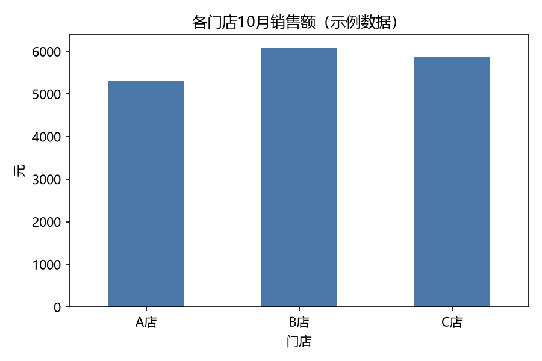
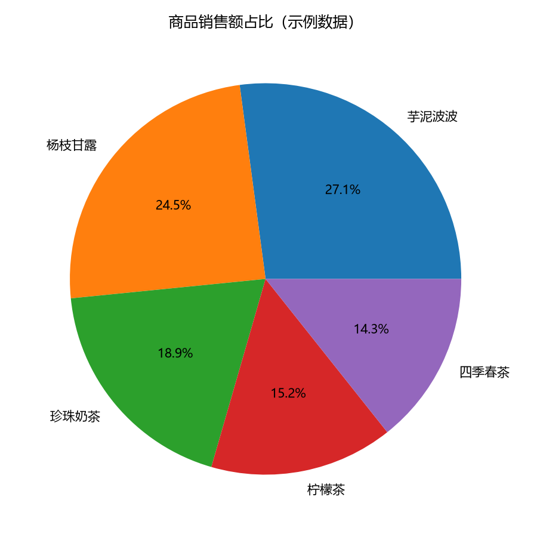
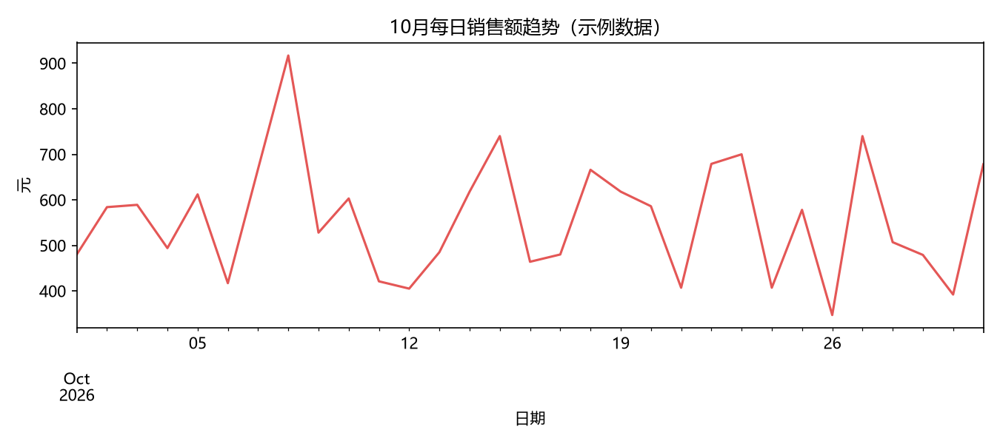

# 销售数据分析项目

这是我的第一个数据分析练习项目：用 Python 把 3 家奶茶店 10 月的销售表合并、清洗，再做统计和画图。

数据是我用脚本随机生成的模拟数据，不是真实经营数据，主要是练习处理流程。

## 我遇到的数据问题

3 张表合在一起共 540 行，里面有这些问题：

- 金额里混进了"元"字，没法直接求和，我把文字去掉后转成了数字
- 日期有两种写法（2026-10-01 和 2026/10/01），统一成了同一种
- 数量有 24 处空值，我用"金额 ÷ 商品单价"把数量算了回来
- 有 93 行重复记录，已经去掉。因为模拟数据没有订单号，我只能按整行完全相同来判断，所以可能多删了一些碰巧一样的记录，真实数据我会用订单号去重

最后剩下 447 行，没有空值。

## 统计结果

- 门店销售额：A店 5313 元，B店 6091 元，C店 5885 元
- 卖得最好的是芋泥波波，共 4688 元
- 工作日平均每天 562 元，周末 546 元，差别不大

## 用到的工具

Python、pandas、matplotlib

## 文件说明

- generate_data.py：生成模拟数据
- clean_data.py：合并和清洗
- analyze.py：统计和画图
- 清洗后_销售数据.csv：清洗后的结果

## 图表

